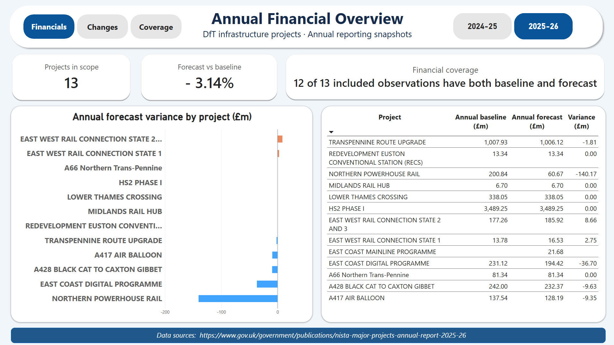
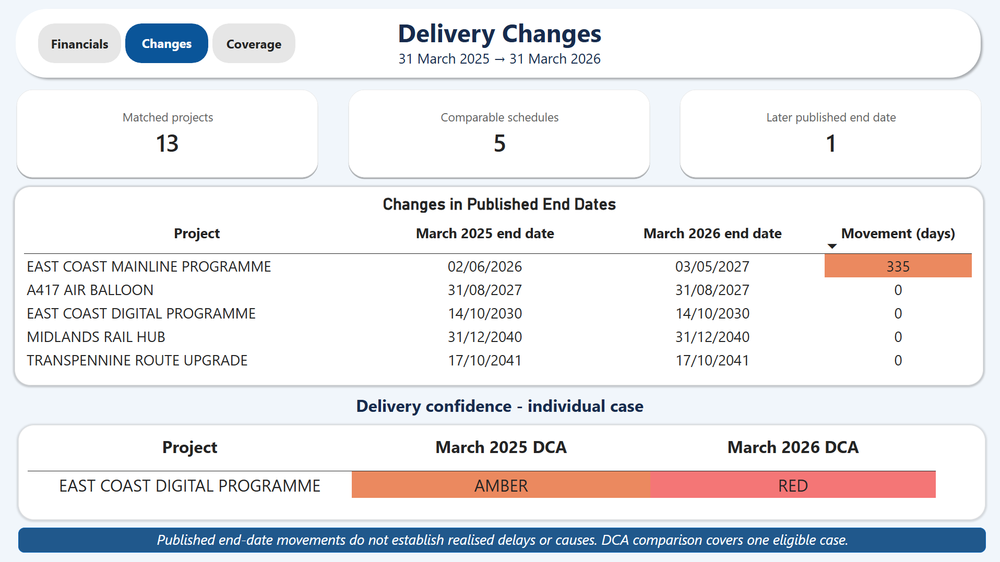
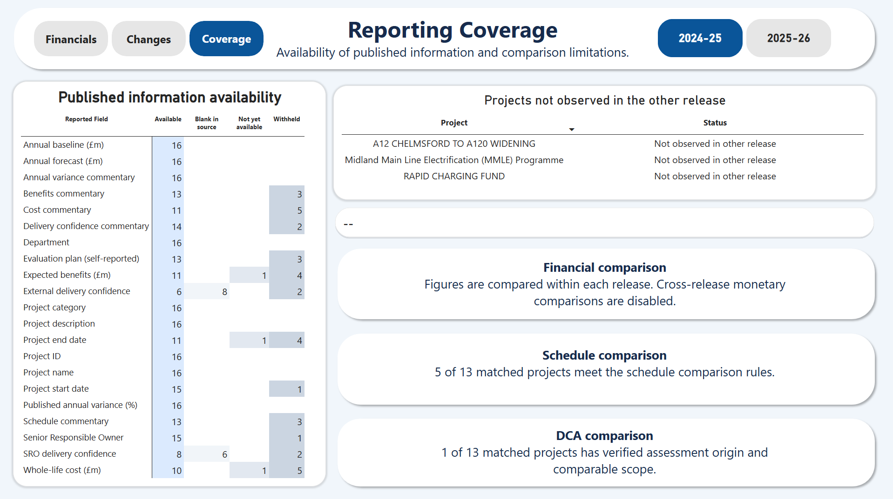

# UK Transport Delivery Monitor

**A Power BI report exploring financial forecasts, published delivery changes and reporting gaps in UK transport infrastructure projects.**

Power BI · DAX · Power Query · Python · pandas · SQL · DuckDB

[View the report (PDF)](reports/UK_Transport_Delivery_Monitor.pdf) · [Download the Power BI file](reports/UK_Transport_Delivery_Monitor.pbix) · [Methodology](docs/methodology.md) · [Power BI setup](docs/powerbi_setup.md)

## Why I built this

My previous work in construction and infrastructure reporting involved supporting project teams in Kazakhstan and stakeholders in Miami. That experience made me interested in how project information is brought together, checked and communicated across different reporting environments.

After completing my MSc in the UK, I wanted to explore the information available on British infrastructure projects. I chose public transport major-project data to investigate three questions: how annual forecasts compare with their baselines, which published delivery dates have changed, and where gaps in disclosure limit analysis.

The result is a report supported by a reproducible data pipeline and documented comparison rules. It is an independent portfolio project using public data, with no affiliation to the organisations or projects covered.

## Report preview

### Financials

Annual forecast variance against baseline, with a reporting-year selector and explicit financial coverage. Positive variance means forecast above baseline; negative variance means forecast below baseline.



### Changes

Published end-date movements for comparable project pairs, followed by the single delivery-confidence case that meets the strict comparison rules.



### Coverage

Availability of published fields, projects without a counterpart in the other release, and a short explanation of the comparison limits.



## Data and scope

The analysis uses project-level CSVs accompanying two government publications:

| Release | Snapshot | Official source | Included DfT infrastructure observations |
|---|---|---|---:|
| 2024–25 | 31 March 2025 | [NISTA Annual Report 2024–25](https://www.gov.uk/government/publications/nista-annual-report-2024-2025) | 16 |
| 2025–26 | 31 March 2026 | [NISTA Major Projects Annual Report 2025–26](https://www.gov.uk/government/publications/nista-major-projects-annual-report-2025-26) | 13 |

The raw files cover the wider government portfolio. The report focuses on reviewed Department for Transport (DfT) projects classified as Infrastructure and Construction.

There are **29 project observations, 16 distinct project keys and 13 confirmed pairs**. An observation is one project in one release, so repeated observations are not counted as separate projects.

## Key findings

| Area | Finding |
|---|---|
| Annual financial variance | Calculated for 28 of 29 observations; all 28 reconcile with the magnitude of the published percentage within 0.1 percentage point |
| Published schedules | Five comparable pairs: one later published end date and four unchanged |
| Delivery confidence | One strictly comparable pair: East Coast Digital Programme, AMBER to RED |
| Unmatched observations | Three projects from 2024–25 were not observed in the later sample |

### A closer look: East Coast Main Line

East Coast Main Line's published end date changes from **2 June 2026 to 3 May 2027**, a movement of **335 days**. It is the only later end date among the five schedule-comparable pairs.

The project's 2025–26 annual baseline is also blank. Its financial variance is therefore left unavailable and excluded from both sides of the aggregate financial calculation.

These are two different observations about the published record. The date movement does not establish a realised delay or its cause, and the absent baseline cannot be interpreted as a zero budget.

## Analytical decisions

Several choices shaped the report more than the visual design:

- **Keep monetary analysis within each release.** The 2025–26 publication introduces 2024/25 real prices and warns against direct comparison with earlier monetary figures. I therefore excluded cross-release cost-growth charts rather than applying an unsupported inflation adjustment.
- **Separate identity from comparability.** Matching the same project across releases does not make every field comparable. Schedule and DCA eligibility are assessed separately, leaving five and one eligible pairs respectively.
- **Use the same financial cohort.** Aggregate baseline and forecast totals include exactly the same eligible observations. The aggregate variance is calculated from those totals, not by averaging project percentages.
- **Preserve missingness reasons.** Blank, withheld and not-yet-available information remain distinct. Unavailable comparisons are never counted as unchanged.
- **Check DCA provenance.** Assessment origin is checked against commentary, rather than inferred solely from a column heading. This deliberately limits the transition analysis to one case.
- **Retain traceability.** Raw values, source references, review decisions and calculation statuses remain available alongside the reporting outputs.

### What I take from the analysis

The strongest conclusion is about the limits of comparison. Although 13 projects can be matched, far fewer support a defensible comparison of schedules or delivery confidence. A dashboard can make those limits visible instead of presenting every missing result as stability.

For a project-controls audience, the report provides a way to identify records requiring closer review and distinguish a reported movement from missing evidence. The small sample does not support conclusions about the performance of UK infrastructure as a whole.

## How it works

| Stage | Implementation | Output |
|---|---|---|
| Inventory | Python source profiling and metadata checks | File manifest, schema and source inventory |
| Preparation | pandas parsing, field mapping and status classification | Observation and field-status tables |
| Matching | Candidate generation and recorded scope/crosswalk decisions | Confirmed pairs and unmatched observations |
| Analysis | DuckDB SQL calculations and validation | Eight Power BI CSV exports |
| Reporting | Power Query, project/release dimensions and DAX | Financials, Changes and Coverage pages |

The Power BI model uses separate project and reporting-release dimensions. Comparison tables span both releases and are kept independent of the reporting-year slicer. The report imports local CSVs; it is not a live connection to the source publications.

## Validation

The recorded pipeline run passed **52 SQL checks and 124 automated tests**. A separate Python standard-library script reproduced 27 checks across five source cases without sharing the build SQL. Repeated runs produced byte-identical exports and unchanged raw-file hashes.

Checks cover keys, join row counts, scope exclusions, calculation eligibility, reconciliation and preservation of source values. These checks support reproducibility; they do not constitute an external audit or exhaustive validation of Power BI interactions.

AI tools assisted with code development, documentation and source-review tasks. Review attribution is retained in the supporting records; those reviews are not presented as independent human sign-off.

## Run the pipeline

The original environment used **Python 3.14 on Windows**. Run the following commands from the repository root. Power BI Desktop is needed only to open or refresh the PBIX; the PDF can be viewed independently.

### 1. Install dependencies

```powershell
py -3.14 -m venv .venv
.\.venv\Scripts\python.exe -m pip install -r requirements-lock.txt
```

### 2. Rebuild the reporting data

```powershell
.\.venv\Scripts\python.exe src/inventory.py
.\.venv\Scripts\python.exe src/prepare.py
.\.venv\Scripts\python.exe src/match.py
.\.venv\Scripts\python.exe src/build.py
```

Keep the supplied files in `data/manual/` and `data/reference/`: they are pipeline inputs. The normal commands preserve existing mapping, scope and crosswalk decisions. No force-overwrite flags are needed.

The scripts regenerate intermediate data and diagnostic reports in `outputs/`, including `build_summary.md` and `source_inventory.md`. Keep any separately edited narrative copies outside those generated paths.

### 3. Run tests and source checks

```powershell
.\.venv\Scripts\python.exe -m pytest -q
.\.venv\Scripts\python.exe src/manual_checks.py --checked-on (Get-Date -Format yyyy-MM-dd)
```

The source-check command writes a new check record with the current date; it does not establish a new human review or source retrieval date.

### 4. Refresh Power BI

Open the PBIX, update its local CSV paths and refresh. Instructions and expected reference values are in [Power BI setup](docs/powerbi_setup.md). Scheduled refresh in Power BI Service is not configured.

## Repository guide

| Location | Contents |
|---|---|
| `reports/` | Power BI report and PDF |
| `docs/` | Methodology, Power BI setup, SQL reference queries and screenshots |
| `src/` | Inventory, preparation, matching, build and source-check scripts |
| `sql/` | Scope, quality, comparison and reconciliation queries |
| `tests/` | Automated tests |
| `data/raw/` | Original source CSVs |
| `data/manual/` | Field mappings, metadata and review decisions |
| `data/reference/` | Verified official source links |
| `data/processed/` | Intermediate tables and eight Power BI exports |
| `outputs/` | Generated diagnostics, SQL check results and local DuckDB database |

## Limitations and attribution

This is a selected sample of published DfT records, not a census of UK infrastructure or a contractor assessment. Monetary values are not compared across releases. The single eligible DCA transition is an individual case. Original download dates are unknown; later hash verification is not a retrieval date.

A wider source-file diagnostic also found one unexplained financial-percentage discrepancy outside the analytical sample. It is documented in the [methodology](docs/methodology.md) and does not enter the report.

Contains public sector information licensed under the [Open Government Licence v3.0](https://www.nationalarchives.gov.uk/doc/open-government-licence/version/3/), except where otherwise stated by the source publications. This attribution concerns the source data and does not grant a separate licence for the project's code.
